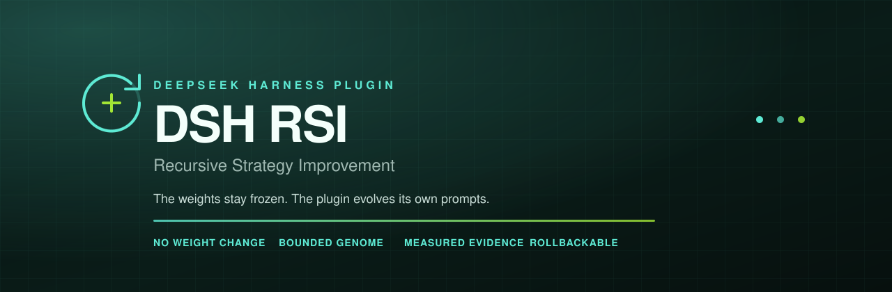
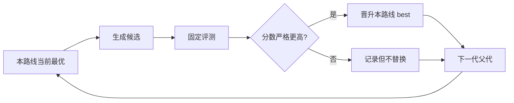

# DSH RSI

<p align="center"></p>

<p align="center">
  <a href="https://github.com/YUEYUEXYS/dsh-rsi/actions/workflows/check.yml"></a>
  <a href="https://github.com/YUEYUEXYS/dsh-rsi/blob/main/LICENSE"></a>
</p>

DeepSeek Harness 插件，不改模型权重。每次进化生成候选策略，在固定评测上打分，只有分数严格高于同一路线当前最优的候选才会晋升。设置页提供当前路线的三目标前沿、策略详情、代际曲线、用户模型、回滚和 genome 导出。仓库：<https://github.com/YUEYUEXYS/dsh-rsi>。

当前版本 `0.1.0`，包名 `dsh-rsi`，许可证 MIT。

## 路线隔离

RSI 把 `provider / model / reasoningEffort` 作为一个路线。不同模型、不同思考档位各有自己的最优策略和证据，不互相继承分数。

- 同一路线内比较适应度，父代取该路线当前最优。
- 新路线从最强的种子策略起步，不和另一条路线的高分策略直接比较。
- `auto` 只自动应用当前路线的最优；`shadow` 只记录；`manual` 需要手动应用。
- 页面顶部显示实际路线，例如 `deepseek-flash · max`。

## 真实运行

2026-11-15 在已安装的 DSH host 上跑过两次，不是测试桩。

| 运行 | 路线 | 结果 | 评测 | 模式 |
| --- | --- | --- | --- | --- |
| 0.4.0 | `deepseek-official / deepseek-flash / max` | `g2-a38456502b5e`，0.99934375（父代 0.64） | 8 / 8，`measured` | `shadow`，active 仍为 `seed-decompose` |
| 0.5.0 | `deepseek-official / deepseek-flash / high` | `g3-5c8ef1d4d9a0`，0.99934375 | 8 / 8，`measured` | 运行后切 `auto`，active 为新最优 |

0.5.0 的 host 重启后仍保留两条独立路线：`max` 的 `g2` 和 `high` 的 `g3` 各自有 `routeBest`。状态文件 `%LOCALAPPDATA%\rsi\genome.json`。

0.4.0 获胜提示词：

```text
直接执行：1) 将任务拆成不超过5个可验证单元，每项写明通过条件；2) 按顺序完成，每项后自检并标记“通过/不通过”；3) 仅合并通过项，不通过先修正；4) 输出前检查格式、约束和遗漏。
```

0.5.0 的提示词和路线隔离记录在 [EVIDENCE.md](./EVIDENCE.md)。

## 工作循环



- 父代是本路线最优，不是每代从种子重启。
- 候选来自 LLM 变异和内置算子变异；第 2 代起包含交叉候选。
- 只有严格更高的候选会晋升；否则保留记录，不回退。
- 策略池上限 96，历史 160 代，账本 800 条，注入提示词上限 7000 字符。
- API 单次进化最多 24 代、8 个候选；设置页提供 1 代和 6 代按钮。

## 策略与算子

种子策略 4 条：

| id | 名称 | 作用 |
| --- | --- | --- |
| `seed-balanced` | 平衡基线 | 理解约束，给结论，交付前做一次低成本检查 |
| `seed-decompose` | 分解者 | 拆成最小可验证单元，逐单元确认 |
| `seed-adversarial` | 反例者 | 先给答案，再构造最可能推翻它的反例 |
| `seed-compress` | 压缩者 | 结论先行，删除不能改变决策的内容 |

算子 10 个：`verify-first`、`decompose`、`format-lock`、`counterexample`、`unknown-boundary`、`first-principles`、`tool-bottleneck`、`compress`、`user-model`、`recursive-audit`。

算子有 `uses` 和 `wins`。后代获胜时，参与该后代的算子增加胜场；下一轮选择算子时按胜率加权。变异方式本身也参与进化。

## 评测

内置 8 道确定性题：

| id | 检查点 |
| --- | --- |
| `exact-logic` | 17 只羊，all but 9 剩下 9 |
| `exact-json` | 严格 JSON，键和值锁死 |
| `exact-list` | 三行，第一行 `red` |
| `exact-math` | `37 * 24 = 888` |
| `exact-count` | `strawberry` 中有 3 个 `r` |
| `exact-date` | 2026-11-14 后一天是 2026-11-15 |
| `exact-csv` | `name,score` + `Ada,10`，无 Markdown |
| `exact-chinese` | 只输出四个汉字：递归进化 |

证据标签：

- `measured`：全部评测题成功调用并按规则打分。
- `partial`：部分题调用失败，只按成功题计算。
- `failed`：全部题调用失败。
- `proxy`：没有 LLM，或关闭真实评测；使用策略结构和算子组合估算。
- `seed`：种子策略，尚未评测。

适应度 = 通过率 0.7 + 答案非空率 0.2 + 长度效率 0.1。真实评测调用当前路线，`reasoningEffort` 取路线记录；未记录时用 `max`。只在用户点击进化时发生。

`proxy` 模式额外计算算子集合的 Jaccard 异度，作为很小的探索加分；它不会被标成 `measured`。

## 安装

从仓库目录执行：

```powershell
powershell -ExecutionPolicy Bypass -File .\install.ps1
```

脚本会建立 `dsh-rsi` junction，备份 profile 的 `package.json`，写入 `link:` 依赖和 bundle，重复执行不会重复添加 bundle。已有指向其他目录的 `dsh-rsi` 链接时脚本会停止，不会覆盖。

装完后重启 DSH desktop。设置入口在左下账户菜单：`设置 Ctrl+,`，打开后左侧导航最底部是 `RSI 配置`。

手工安装：

```powershell
New-Item -ItemType Junction -Path "$env:USERPROFILE\.dsh\profiles\desktop\node_modules\dsh-rsi" -Target 'D:\RSI'
```

然后在 `%USERPROFILE%\.dsh\profiles\desktop\package.json` 的 `dependencies` 加入 `"dsh-rsi": "link:D:/RSI"`，在 `dsh.profile.bundles` 末尾加入 `"dsh-rsi"`。

## 设置页

- 实时进度：当前代、候选序号、当前评测题。
- 三目标前沿：当前路线的 `最强 / 最省 / 最异`。
- 策略详情：点击策略名，查看完整提示词、算子、父代、适应度和 8 个评测点。策略库是全局池，跨路线条目仍可见；顶部 BEST、三目标前沿和 ACTIVE 按当前路线过滤。
- 代际曲线：父代到本代最优的谱系。
- 用户模型：自动提取 + 手动编辑，最多 16 条。
- 导出 genome：下载 JSON，包含策略池、历史、账本和用户模型。
- 新装默认 `auto`：只晋升严格更高分；已有状态保留原来的模式。

## HTTP API

前缀 `/rsi`，同源访问。

| 方法 | 路径 | 作用 |
| --- | --- | --- |
| GET | `/api/state` | 当前快照，含 `pluginVersion`、`routeKey`、`routeBestId`、`benchmarks`、`front` |
| GET | `/api/export` | 导出完整 genome |
| POST | `/api/evolve` | `{ generations, candidates, useLlm, route }`；`route` 支持 `{ provider, model, reasoningEffort }` |
| POST | `/api/apply` | `{ id }` |
| POST | `/api/rollback` | 回滚到上一策略或基线 |
| POST | `/api/profile` | 保存用户模型 |
| POST | `/api/profile/clear` | 清空用户模型 |
| POST | `/api/mode` | `shadow` / `manual` / `auto` |
| POST | `/api/enabled` | 注入开关 |
| POST | `/api/reset` | 重置策略，保留用户模型 |

并发进化返回 `BUSY` / HTTP 409。

## 与 Think Ultra 的边界

- RSI 不注册 LLM adapter，不包装 `UltraAdapterInstaller`。
- RSI 不修改 Think Ultra 的 `ultra -> max` 映射。
- RSI 的 system prompt section 使用 `order: 10001`，只增加自己的策略段。
- RSI 的评测请求使用当前路线记录的档位，不影响用户会话的档位选择。
- 两者同时启用时，用户当前明确指令优先于 RSI 策略。

## 测试

```powershell
node D:\RSI\tools\check.mjs
# 或
npm test
```

`check.mjs` 先做三个源文件的语法检查，再执行 engine / host / client 三个测试：

```text
CHECK_PASS
RSI_ENGINE_TEST_PASS
RSI_HOST_TEST_PASS
RSI_CLIENT_TEST_PASS
RSI_CHECK_PASS
```

client 测试不是只渲染 loading 状态。它会构造完整 snapshot，断言：

- 根节点是 `div.rsi-page`；
- `三目标前沿`、`进化控制台`、`策略库`、`用户模型`、`代际曲线`、`运行日志` 都存在；
- 点击策略名后的详情面板可见；
- 导航图标替换会写入 `data-rsi-icon=loop` 并生成 4 条 path。

## 运行验证

```powershell
Get-Content "$env:LOCALAPPDATA\rsi\host.json"
# {"version":"0.1.0", ...}

Invoke-WebRequest http://127.0.0.1:<host-port>/rsi/api/state
# HTTP 200，pluginVersion=0.1.0，benchmarks=8，routeBestId 存在
```

DSH renderer 会在 localStorage 写入 `dsh-rsi:client` 和 `dsh-rsi:section`，两者都包含版本和注册结果。host 端口每次启动动态分配，以实际监听端口为准。

## 设计边界

- 任务级策略 RSI，不是模型级 RSI。提示词进化不能把底座变成另一个模型。
- 8 道题只覆盖精确性、格式和成本，不覆盖开放式写作、长程工具编排、视觉任务。
- 真实验证只有 1 代、2 个候选、1 条路线；不是统计结论。
- 路线隔离能防止跨模型分数串线，但不能证明某路线一定强于其他模型。
- 用户模型是规则提取，不是 LLM 深度画像；复杂偏好需要手动补条目。
- `auto` 仍受“严格更高分”约束；连续多代没有更高分时会停在原地。
- MIT 开源，源码可见，按 `LICENSE` 授权复制、修改和分发。

## 文件

```text
lib/engine.js      核心引擎
lib/index.js       host 插件、prompt section、/rsi API
lib/client.js      设置页与导航图标
tools/check.mjs    统一检查入口
tools/test_*.mjs   分项测试
install.ps1        DSH profile 安装脚本
EVIDENCE.md        真实运行记录与边界
.github/workflows   CI
README.md          本文档
LAUNCH.md          发布页与演示脚本
CHANGELOG.md       版本记录
assets/            品牌横幅
```

## 许可证

MIT License，见 `LICENSE`。
